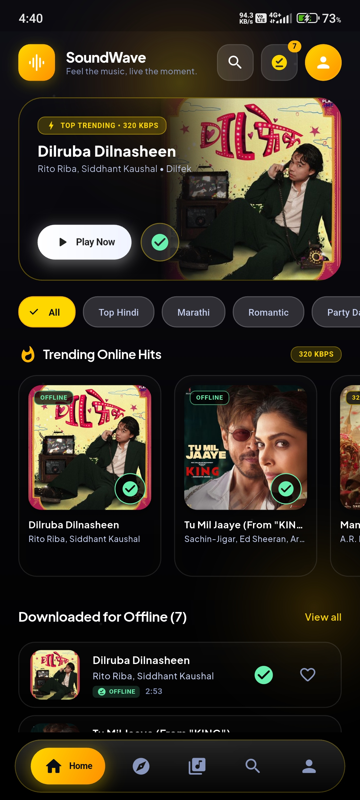
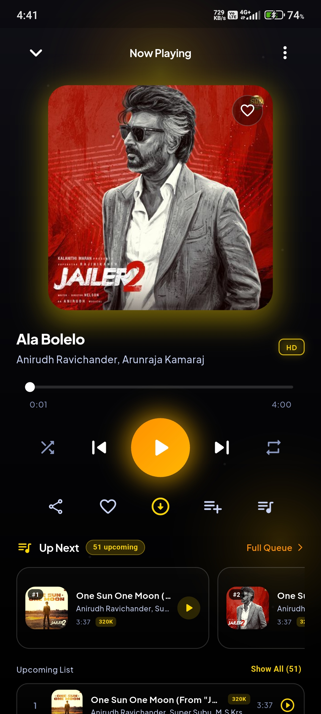
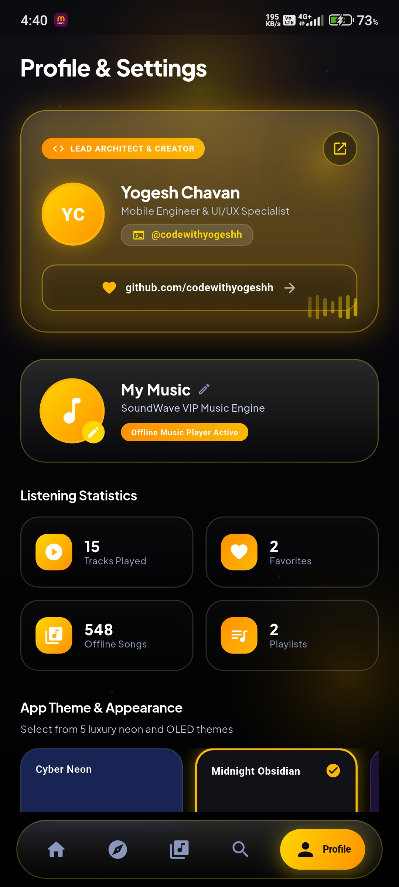

# SoundWave

A modern, offline-first Flutter music player with 320 kbps online streaming, high-resolution offline cover banner caching, background playback controls, and 5 dynamic OLED & neon themes.

**Latest Android release: v1.3.2 (build 6)** · [Download the APK](https://github.com/codewithyogeshh/SoundWave-Feel-The-Music-/releases/tag/v1.3.2)

## Live Demo

Try it in the browser: **[getsoundwave.vercel.app](https://getsoundwave.vercel.app)**

## Install on Android

1. Open the [v1.3.2 release page](https://github.com/codewithyogeshh/SoundWave-Feel-The-Music-/releases/tag/v1.3.2) on your phone and tap **`soundwave-v1.3.2.apk`** to download it (about 75 MB). The app needs Android 7.0 (API 24) or newer.
2. Open the downloaded file. If Android blocks it, tap **Settings** in the prompt and allow **Install unknown apps** for whichever app you downloaded with (Chrome, Files, etc.).
3. **Coming from an older SoundWave (1.3.1 or earlier)?** Uninstall it first. Each release is signed with a fresh debug key, so Android refuses to install this build over an older one and shows "App not installed". Uninstalling also removes saved settings and downloaded tracks.
4. Tap **Install**, then **Open**.
5. On first launch, grant the music-library permission so the local library scan can find the songs on your device. Online streaming and search work without it.

Once v1.3.2 is installed you no longer need to look for new APKs: the app checks GitHub when it starts and shows an **Update available** sheet with a direct **Download APK** button whenever a newer release exists.

> The web build supports online streaming, search and playback. Downloads and local-device music scanning are mobile-only features, since browsers can't write to device storage or read the phone's music library.

## Screenshots

<p align="center">
  
  
  
</p>

<p align="center"><em>Home &amp; Trending &nbsp;·&nbsp; Now Playing &nbsp;·&nbsp; Profile &amp; Settings</em></p>

## Key Features

- **Single-Stream Audio Engine (`just_audio` + `audio_service`)**: Guaranteed single-track playback with monotonic generation tracking, audio focus handling, lockscreen / notification media controls, and zero overlapping playback.
- **Offline Downloads with Cover Banners**: Save tracks in-app or export to `/Music/SoundWave` alongside 500x500 cover banners cached locally for offline playback, UI rendering, and notification/lockscreen artwork.
- **5 Dynamic Luxury Themes**: Live theme switching across **Cyber Neon**, **Midnight Obsidian (OLED)**, **Royal Amethyst**, **Emerald Aurora**, and **Crimson Eclipse** with full Material 3 surface & accent synchronization.
- **Now Playing Studio**: Swipeable MiniPlayer (swipe left/right to skip), interactive Up Next queue, working Sleep Timer with live countdown, Equalizer presets, and Track Audio Specs.
- **Smart Library & Discovery**: Local device audio scanning (`on_audio_query`), multi-criteria filtering & sorting, custom playlists, favorites, and pull-to-refresh online feeds with offline fallback.

## What's New in 1.3.2

- **In-app update prompt**: the app checks the latest GitHub release a few seconds after launch and shows an **Update available** dialog with a **Download APK** button, so a new build no longer has to be hunted for by hand. The check is silent when offline and only runs in the Android build.

### Earlier in 1.3.1

- **Equalizer Studio Pro** with presets and per-band tuning.
- **Synced lyrics** from LRCLIB with karaoke-style highlighting.
- **Queue reordering**, a smart **Sleep Timer** and **true shuffle** playback.
- **Recommended tracks carousel** and interactive listening statistics.
- **Midnight Obsidian** as the default OLED theme, dynamic genre filter chips, and a polished Explore screen layout.
- Exit confirmation popup so a back press no longer kills playback by accident.

## Tech Stack

- **Framework**: Flutter (Material 3)
- **State Management**: Riverpod (`flutter_riverpod`)
- **Audio & Media**: `just_audio`, `audio_service`, `audio_session`, `on_audio_query`
- **Storage & Caching**: `shared_preferences`, `path_provider`, `cached_network_image`

## Getting Started

```bash
# 1. Install dependencies
flutter pub get

# 2. Run static analysis
flutter analyze

# 3. Run unit & widget tests
flutter test

# 4. Run on a connected device
flutter run

# 5. Build release APK (the version comes from pubspec.yaml)
flutter build apk --release --dart-define=SOUNDWAVE_VERSION=1.3.2
```

Release APKs are built automatically by GitHub Actions: pushing a `v*` tag (or running the **Build APK** workflow manually) builds the APK and attaches it to a GitHub release. The workflow reads `version:` from `pubspec.yaml` and bakes it into the build, which is what the in-app update check compares against the latest release.

## Author

Designed & built by **Yogesh Chavan** ([@codewithyogeshh](https://github.com/codewithyogeshh)).
